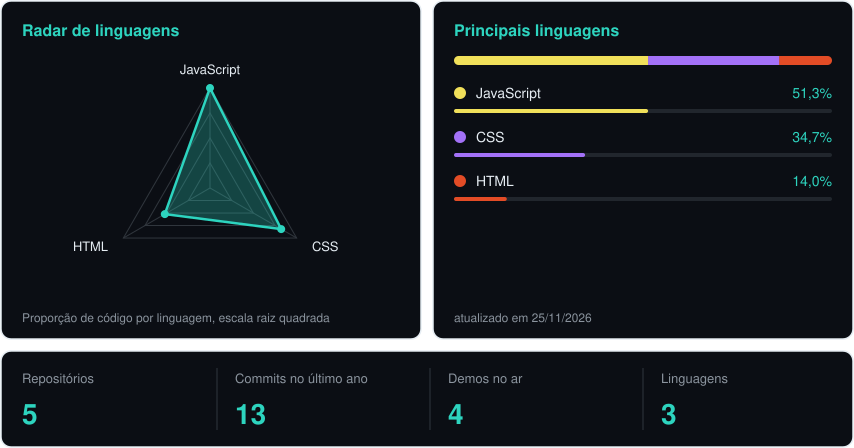

<h2 align="center">About Me</h2>

<ul>
<li>🚀 Construindo agora: <b>Dashboard de Gastos</b>, um painel financeiro pessoal em React</li>
<li>🎯 Objetivo: minha primeira vaga como dev front-end / full-stack júnior</li>
<li>📚 Aprendendo: React e boas práticas de JavaScript moderno</li>
<li>📬 Aberto a: estágio, vaga júnior e freelas</li>
<li>💬 Dúvidas ou proposta? Me chama, respondo rápido!</li>
</ul>

<h2 align="center">Projetos em destaque</h2>

<table>
<tr>
<td width="50%" valign="top">
<h3><a href="https://github.com/takkedaz/dashboard-gastos">💰 Dashboard de Gastos</a></h3>

Controle financeiro pessoal em React: CRUD de transações, filtros, resumo de saldo e gráfico de despesas por categoria. Dados persistidos no navegador.

<code>React</code> <code>Chart.js</code> <code>GitHub Actions</code>

<a href="https://takkedaz.github.io/dashboard-gastos/"><b>Ver demo</b></a>

</td>
<td width="50%" valign="top">
<h3><a href="https://github.com/takkedaz/lista-de-tarefas">✅ Lista de Tarefas</a></h3>

To-do list com filtros por status, edição inline e persistência de dados entre sessões.

<code>JavaScript</code> <code>HTML5</code> <code>CSS3</code>

<a href="https://takkedaz.github.io/lista-de-tarefas/"><b>Ver demo</b></a>

</td>
</tr>
<tr>
<td width="50%" valign="top">
<h3><a href="https://github.com/takkedaz/previsao-tempo">🌦️ Previsão do Tempo</a></h3>

Consulta de clima em tempo real integrando uma API pública, com tratamento de erros e estados de carregamento.

<code>JavaScript</code> <code>API REST</code>

<a href="https://takkedaz.github.io/previsao-tempo/"><b>Ver demo</b></a>

</td>
<td width="50%" valign="top">
<h3><a href="https://github.com/takkedaz/portfolio">🧑‍💻 Portfólio</a></h3>

Minha página pessoal, com console interativo no terminal embutido na própria página.

<code>HTML5</code> <code>CSS3</code> <code>JavaScript</code>

<a href="https://takkedaz.github.io/portfolio/"><b>Ver demo</b></a>

</td>
</tr>
</table>

<h2 align="center">Languages and activity</h2>

  
  
  
  
  
  
  

<h2 align="center">Contacts</h2>

  
  
  
  

